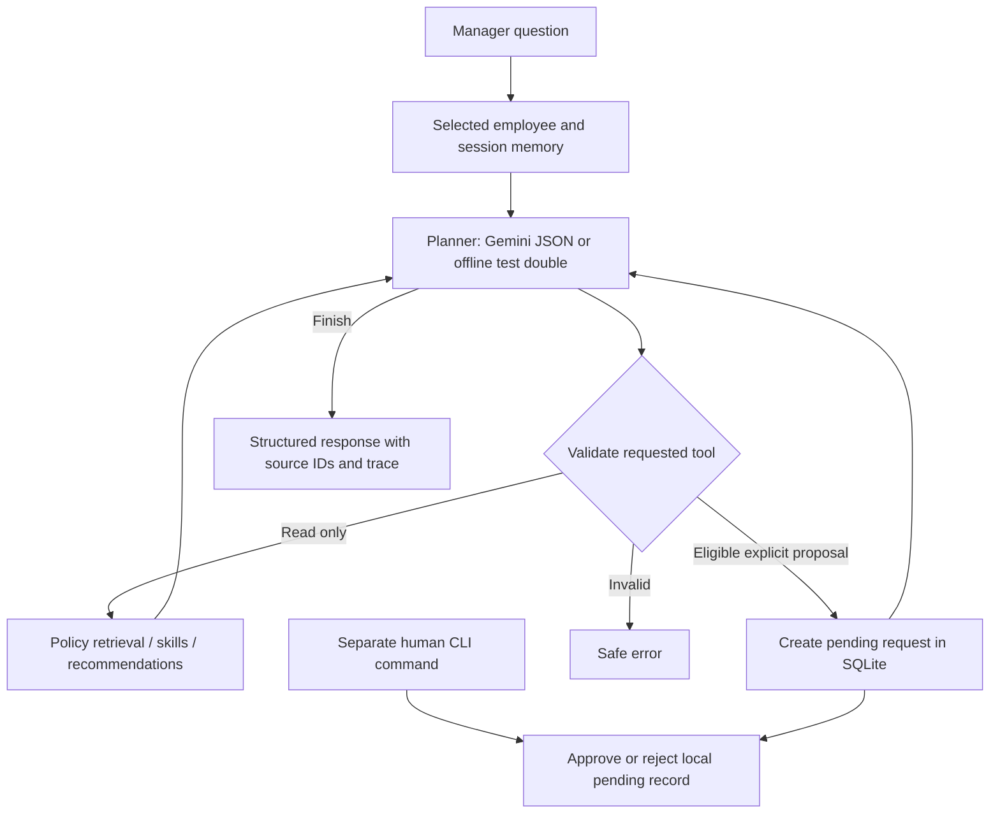

# WorkforceAI | Bounded workforce intelligence agent

A Python portfolio prototype for a workforce learning and development scenario, inspired by the RAWRCO Junior AI Agent Engineer vacancy. Not affiliated with RAWRCO. Uses entirely fictional data.

## Problem
A manager asks what training an employee needs. Rather than hard-coding every sequence, a model-backed planner can choose which tools to call, observe their results, and decide when to stop. A human, not the model, decides on any proposed training request.

## Quick start (no API key, no dependencies)
Python 3.10+ and a terminal are sufficient. Extract the repository and open a terminal in its folder.

```powershell
python main.py --ask "Recommend training for E001"
python main.py --ask "Propose Python training for E001"
python main.py --ask "What is the training approval policy?"
python -m unittest discover -s tests -v
```
The default offline demo is a deterministic planner, not LLM inference. It exercises the same tools, state and guardrails without a network. Copy the pending request ID from `pending_requests`, then use the separate human decision command (replace `REQUEST_ID`):

```powershell
python main.py --approve REQUEST_ID
```
Use `--reject REQUEST_ID` instead to reject. A decision only changes a local SQLite record; it does not enroll a person. For a conversation use `python main.py`. The default session persists to `workforce.db`; use `--session other` for a separate context. Session names are an isolation demonstration, not authentication.

## Live LLM mode
Create a Gemini API key at https://aistudio.google.com/apikey. Review applicable pricing/quota before calling; a free tier is not guaranteed for every model. In Windows PowerShell:

```powershell
$env:GEMINI_API_KEY = "YOUR_KEY"
$env:GEMINI_MODEL = "gemini-3.8-flash"
python main.py --live --ask "Recommend training for E001 and explain the policy"
```
Use an available Gemini model if the default is not accessible. In macOS/Linux use `export GEMINI_API_KEY=...` and `export GEMINI_MODEL=...`. Do not commit API keys. The model is called via the documented Gemini OpenAI-compatible REST endpoint; model output is parsed as JSON. See https://ai.google.dev/gemini-api/docs/openai. No real human resources data should be entered. The live API path is implemented but has not been exercised with real credentials in this environment.

## Architecture


- **Agent loop:** bounded to six planner steps; the planner selects a JSON action, uses observed results and chooses the next action. Tool invocation is application-managed rather than provider-native function calling. Offline demo is rules-based, not autonomous LLM inference.
- **Retrieval:** ranks small policy documents by token overlap and passes relevant text to the planner. In live mode, this is a simple lexical retrieval-augmented generation implementation. It is not vector search or embeddings.
- **Memory:** SQLite stores selected employee context per session; previous full conversations are not retained. A tool audit records observations and decisions.
- **Human oversight:** model cannot call approval or rejection. A proposal is a non-executing pending draft that requires an explicit course request, matching employee context, observed skills gaps and approval policy, and a catalog cost within R1,500. No external actions are integrated.
- **Structured outputs:** action objects and required keys are validated; final output includes mode, status, answer, retrieved policy IDs, pending request IDs and tool trace. Sources identify retrieved evidence, but automated factual citation validation is not implemented.
- **Safety:** fictional data, tool allowlist, identifier matching, argument validation, duplicate call check, cost constraint and explicit local human decisions. Employment decision keywords are screened as a basic demonstration, not a comprehensive prompt injection defense.

## Evaluation
Run `python -m unittest discover -s tests -v`. Included tests cover policy retrieval, missing evidence, memory isolation, proposal and human decision handling, rejection, invalid employees/courses, employment decision blocking, unknown tool, employee mismatch, missing explicit request and a scripted model loop. `test-results.txt` and `demo-output.json` contain actual local run output. These are deterministic/mock tests, not a measure of live model accuracy.

## Limitations and next steps
- Live API integration is unverified until a credentialed run; models, quotas and responses can change.
- Retrieval is small-scale lexical search. Add embeddings/vector retrieval and recall evaluation if policy documents grow.
- Model responses can contain unsupported claims; validate citations and use a robust red-team test set before production.
- Local sessions do not authenticate identity or enforce roles. Add real RBAC, audit integrity, consent, retention controls and POPIA review before handling actual HR data.
- Explicit proposal detection uses simple lexical checks; not a full natural-language authorization system. Add a separate confirmed proposal form for production.
- No employment ranking, hiring, dismissal, external enrolment, or HR-system integration is supported.

## AI assistance disclosure
This initial portfolio prototype, tests and documentation were generated with ChatGPT assistance. The applicant should run the code, verify the outputs and be able to explain or modify the architecture before presenting the work. No claim of independent development or completed live integration is made.
